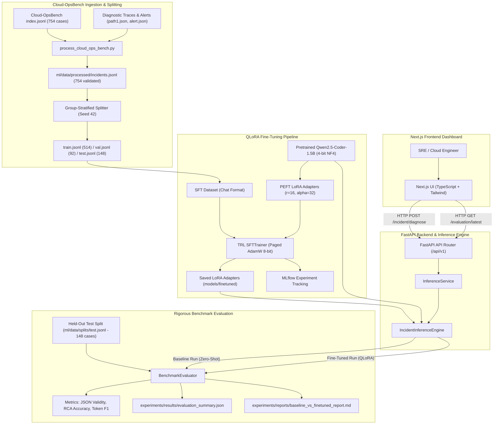
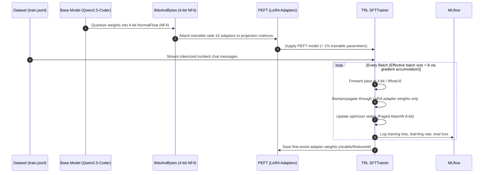
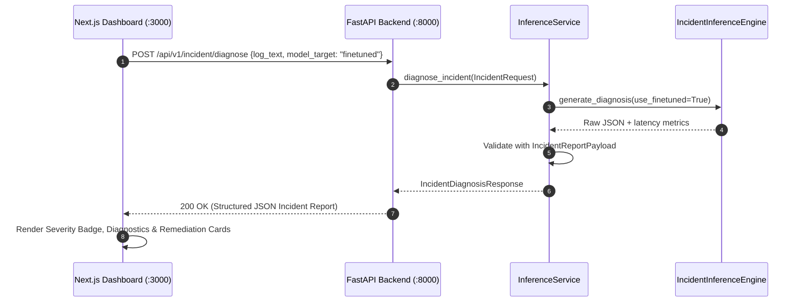

# FineTuneOps: System Architecture Documentation

**Document Version:** 2.0.0  
**Project:** FineTuneOps  
**Scope:** LLM Fine-Tuning Platform for Kubernetes & Cloud Microservice Incident Diagnosis (Cloud-OpsBench)  

---

## 1. Overall System Architecture

FineTuneOps is an end-to-end platform designed to fine-tune, evaluate, and serve open-source instruction-tuned LLMs (`Qwen2.5-Coder-1.5B-Instruct`) specialized for **Kubernetes and cloud-native microservice Root Cause Analysis (RCA)**.

The system's dataset and evaluation ground truth are built upon the official public **Cloud-OpsBench** benchmark (`LLM4Ops/Cloud-OpsBench`), covering 754 real-world microservice incident snapshots across Google Cloud's *Online Boutique* and Fudan University's *TrainTicket*.

---

## 2. Dataset Preparation Pipeline

The dataset pipeline transforms raw Cloud-OpsBench benchmark state snapshot artifacts into clean, structured instruction-tuning pairs.

### 2.1 Scope & Source Provenance
- **Dataset:** Official `LLM4Ops/Cloud-OpsBench` v1.0.0 (Git Commit `ea05dafbc87b5985df8721622d63d4229c2b4224`).
- **Domain Focus:** Kubernetes & Cloud-Native Microservices (Online Boutique & TrainTicket).
- **Taxonomies:** `Scheduling_Fault`, `Runtime_Fault`, `Application_Code_Defect`, `Service_Routing_Fault`, `Startup_Fault`, `Performance_Fault`, `Admission_Fault`, `Infrastructure_Fault`.

### 2.2 Canonical Record Schema
Every training and evaluation sample follows the `DevOpsIncidentRecord` and canonical `IncidentReportPayload` schema:
- `incident_category`: Enum (`Kubernetes / Container Orchestration`, `Application`, `Infrastructure`, `Database`, `Network`).
- `severity_level`: Enum (`Critical`, `High`, `Medium`, `Low`).
- `root_cause_analysis`: Thorough diagnostic synthesis identifying the faulty component (`fault_object`) and underlying mechanism (`root_cause`).
- `contributing_factors`: Concrete architectural and environmental conditions.
- `recommended_debugging_steps`: Actionable diagnostic commands extracted from benchmark tool invocations (`kubectl get pods`, `kubectl describe`, `kubectl logs`).
- `suggested_remediation_actions`: Factual disclaimer noting that Cloud-OpsBench is strictly an RCA benchmark and does not distribute remediation actions.

### 2.3 Input/Output Separation (Zero Target Leakage)
- **Model Input:** Exclusively contains user incident query, cluster namespace, and raw observed diagnostic telemetry (`path1.json` tool traces and `alert.json` metrics).
- **Target Response:** Ground-truth fault taxonomy, affected component, root cause mechanism, and diagnostic explanation. Ground truth fields are strictly forbidden from model inputs.

### 2.4 Deterministic Group-Stratified Splitting
To eliminate data leakage, cases are grouped by `(system::category::root_cause)`:
- **Training Split (68.2% / 514 cases):** Supervised fine-tuning.
- **Validation Split (12.2% / 92 cases):** Evaluation loss monitoring.
- **Held-Out Test Split (19.6% / 148 cases):** Strictly locked for final head-to-head benchmarking.
- **Zero Cross-Split Overlap:** 0 scenario groups cross split boundaries.

---

## 3. Baseline Inference Pipeline

The baseline pipeline models a zero-shot, un-adapted instruction model solving DevOps incident diagnosis:

1. **Model Loading:** The unmodified `Qwen/Qwen2.5-Coder-1.5B-Instruct` is instantiated without any parameter updates or adapters.
2. **Prompt Formulation:** The identical system prompt and user input template are passed into `tokenizer.apply_chat_template()`.
3. **Deterministic Decoding:** Inferences are executed with deterministic settings:
   - `temperature = 0.1`
   - `top_p = 0.95`
   - `max_new_tokens = 768`
   - `do_sample = False`
4. **Structured JSON Extraction:** The model output passes through `extract_json_payload()` to isolate the JSON object from potential markdown wrappers or preamble chatter.

---

## 4. QLoRA Fine-Tuning Pipeline

Fine-tuning adapts the model to internalize DevOps log structures, failure patterns, and strict JSON output schemas while minimizing compute overhead.

### 4.1 Hyperparameter Specifications
- **Base Model:** `Qwen/Qwen2.5-Coder-1.5B-Instruct`
- **Quantization:** 4-bit NormalFloat (NF4), double quantization enabled (`bnb_4bit_use_double_quant=True`), compute dtype `bfloat16` (or `float16`).
- **LoRA Configuration:**
  - Rank ($r$): 16
  - Scaling factor ($\alpha$): 32
  - Dropout: 0.05
  - Target modules: All linear projection matrices (`q_proj`, `k_proj`, `v_proj`, `o_proj`, `gate_proj`, `up_proj`, `down_proj`).
- **Optimization:**
  - Optimizer: `paged_adamw_8bit`
  - Learning rate: $2.0 \times 10^{-4}$ with cosine decay schedule
  - Warmup ratio: 0.03
  - Batch size: 1 per device, 8 gradient accumulation steps (effective batch size = 8)
  - Gradient checkpointing: enabled (drastically reduces activation memory)

---

## 5. Fine-Tuned Inference Pipeline

1. **Base Layer:** The base model is loaded once in 4-bit or 16-bit precision.
2. **Adapter Layer:** The lightweight PEFT adapter weights (`adapter_model.safetensors`, `adapter_config.json`) are layered onto the base model using `PeftModel.from_pretrained()`.
3. **Execution:** Input logs are passed into the exact same chat template and generation hyperparameters as the baseline.
4. **Validation:** The resulting text is parsed into `IncidentReportPayload`. Because domain fine-tuning aligns the model directly to the JSON structure, JSON parsing validity approaches 100% with near-zero syntax errors.

---

## 6. Evaluation Pipeline

Under the project requirements, **only two configurations are compared**:

$$\text{Configuration A: Baseline Pretrained Model} \quad \text{vs.} \quad \text{Configuration B: QLoRA Fine-Tuned Model}$$

- **Zero Variance Protocol:** Both configurations must be evaluated on the **exact same held-out test split**, utilizing the **exact same system/user prompts**, and under **identical generation parameters**.
- **No RAG, DPO, or Third-Party Baselines:** The comparison focuses strictly on the delta induced by domain-specialized Supervised Fine-Tuning.

### Metrics Computed
1. **JSON Syntax Validity Rate:** Percentage of generations that parse into a valid JSON object.
2. **Schema Compliance:** Percentage of outputs satisfying all required Pydantic schema attributes.
3. **Category Exact Match Accuracy:** Agreement with ground truth incident categories.
4. **Severity Exact Match Accuracy:** Agreement with ground truth severity ratings (SEV-1 through SEV-4).
5. **Root Cause Token F1 / ROUGE-L:** Lexical overlap between generated root causes and domain expert annotations.
6. **Inference Latency & Throughput:** Time-to-first-token and total generation latency in milliseconds.

---

## 7. Backend and Frontend Communication

- **Protocol:** HTTP REST with JSON payloads over CORS-enabled channels.
- **Endpoints:**
  - `POST /api/v1/incident/diagnose`: Real-time incident diagnosis.
  - `GET /api/v1/evaluation/latest`: Retrieve most recent benchmark comparison results.
  - `POST /api/v1/evaluation/run`: Trigger benchmark run over the test split.
  - `GET /api/v1/health`: Liveness probe and configuration status.
  - `GET /api/v1/hardware`: System memory, GPU VRAM, and storage diagnostics.

---

## 8. Model Loading and Deployment Strategy

1. **Decoupled Architecture:** Training (`ml/training/`) and Serving (`backend/`) are decoupled. The backend only requires the inference engine and adapter weights, never the training dependencies or optimizer state.
2. **Lazy Loading & Cache Management:** Weights are loaded on-demand. When running in memory-constrained environments, `models_baseline` and `models_finetuned` can be loaded selectively.
3. **Docker Containerization:**
   - `docker/Dockerfile.backend`: Light Python 3.10 slim container hosting FastAPI.
   - `docker/Dockerfile.frontend`: Multi-stage Node.js alpine container serving standalone Next.js.
   - `docker-compose.yml`: Coordinates services, mounting `models/`, `ml/data/`, and `experiments/` as host volumes.
