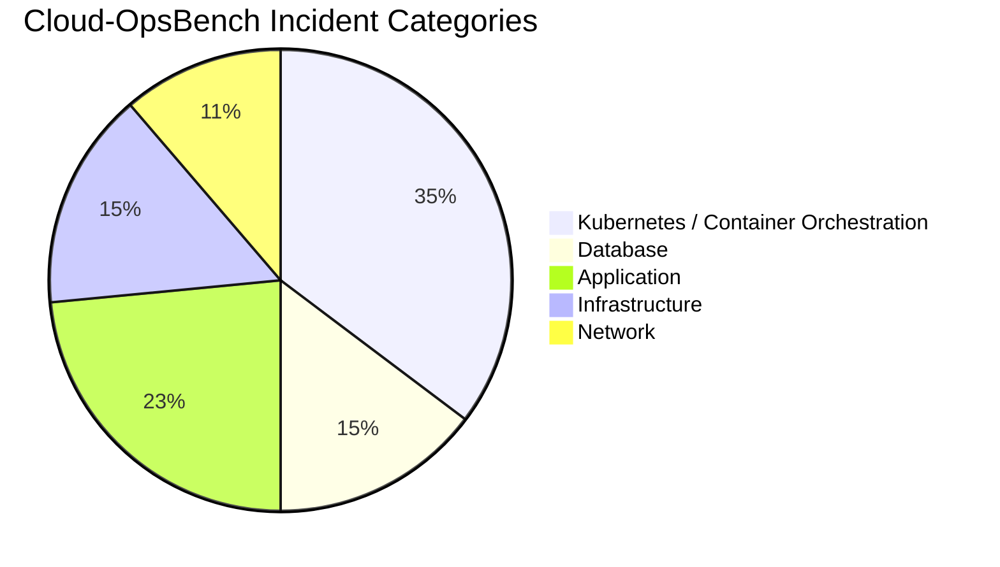
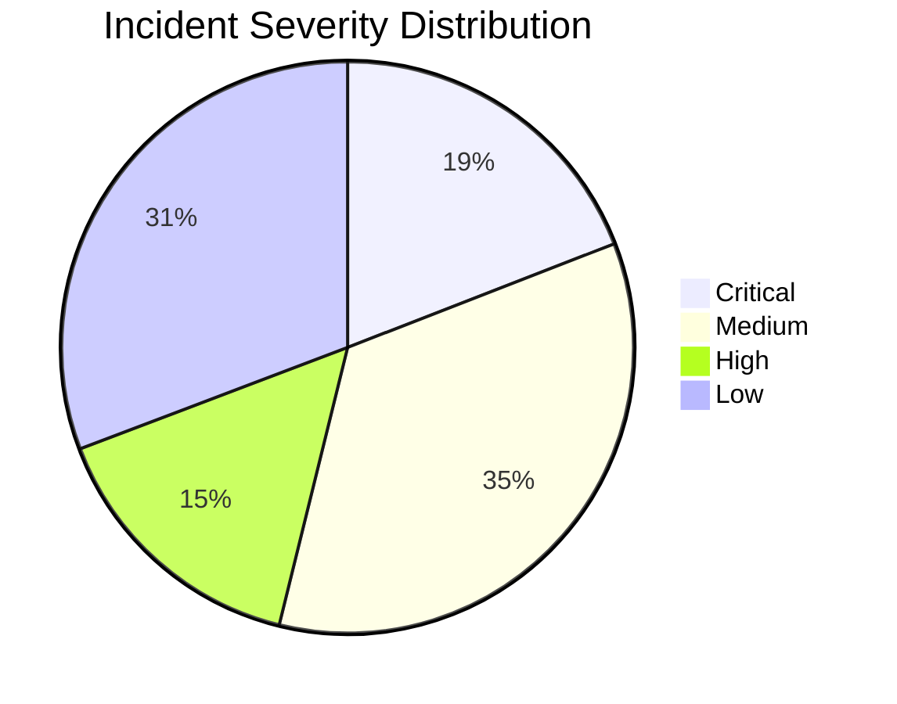

# FineTuneOps: Cloud-OpsBench Dataset Quality & Leakage Audit Report

**Date:** October 31, 2026  
**Auditor:** Senior ML Data Engineer  
**Dataset Source:** `LLM4Ops/Cloud-OpsBench` (v1.0.0, Git Commit `ea05dafbc87b5985df8721622d63d4229c2b4224`)  
**License:** MIT License  
**Scope:** Kubernetes & Microservices Root Cause Analysis (RCA)  

---

## 1. Executive Summary

The official public benchmark dataset **Cloud-OpsBench** was integrated into FineTuneOps to train and evaluate `Qwen2.5-Coder-1.5B-Instruct` on Kubernetes and cloud-native microservice incident diagnosis.

- **Total Validated Records:** **754**
- **Synthetic Examples Created:** **0** (100% public benchmark empirical telemetry)
- **Schema Validation Pass Rate:** **100.0%** (validated via Pydantic `DevOpsIncidentRecord` & `IncidentReportPayload`)
- **Data Leakage Check:** **PASSED** (0 scenario groups overlap between train, val, and test splits)
- **Missing Field Count:** **0**

---

## 2. Dataset Split Breakdown

| Split | Count | Percentage | Target Ratio |
| :--- | :--- | :--- | :--- |
| **Training Split (`train.jsonl`)** | **514** | **68.2%** | ~70% |
| **Validation Split (`val.jsonl`)** | **92** | **12.2%** | ~15% |
| **Held-Out Test Split (`test.jsonl`)** | **148** | **19.6%** | ~15% |
| **Total** | **754** | **100.0%** | 100% |

---

## 3. Incident Category Distribution

| Category | Total Count | % of Total | Train | Validation | Test |
| :--- | :--- | :--- | :--- | :--- | :--- |
| **Kubernetes / Container Orchestration** | 266 | 35.3% | 189 | 30 | 47 |
| **Application** | 177 | 23.5% | 129 | 26 | 22 |
| **Infrastructure** | 115 | 15.3% | 64 | 4 | 47 |
| **Database** | 111 | 14.7% | 75 | 11 | 25 |
| **Network** | 85 | 11.3% | 57 | 21 | 7 |

---

## 4. Severity Distribution

| Severity Level | Total Count | % of Total | Train | Validation | Test |
| :--- | :--- | :--- | :--- | :--- | :--- |
| **Critical** | 144 | 19.1% | 85 | 33 | 26 |
| **High** | 116 | 15.4% | 65 | 4 | 47 |
| **Medium** | 262 | 34.7% | 211 | 6 | 45 |
| **Low** | 232 | 30.8% | 153 | 49 | 30 |

---

## 5. Root Cause Diversity (Top 15 out of 57 unique root causes)

| Rank | Root Cause Key | Count | % of Total |
| :--- | :--- | :--- | :--- |
| 1 | `pod_network_delay` | 57 | 7.6% |
| 2 | `node_selector_mismatch` | 32 | 4.2% |
| 3 | `incorrect_image_reference` | 28 | 3.7% |
| 4 | `taint_toleration_mismatch` | 24 | 3.2% |
| 5 | `node_affinity_mismatch` | 24 | 3.2% |
| 6 | `service_selector_mismatch` | 24 | 3.2% |
| 7 | `mysql_invalid_credentials` | 24 | 3.2% |
| 8 | `missing_secret_binding` | 24 | 3.2% |
| 9 | `mysql_invalid_port` | 22 | 2.9% |
| 10 | `code_missing_parameter` | 20 | 2.7% |
| 11 | `gateway_misrouted` | 19 | 2.5% |
| 12 | `cpu_capacity_mismatch` | 18 | 2.4% |
| 13 | `memory_capacity_mismatch` | 18 | 2.4% |
| 14 | `missing_image_pull_secret` | 18 | 2.4% |
| 15 | `service_sidecar_port_conflict` | 18 | 2.4% |

---

## 6. Target Leakage & Clean Room Audit

To strictly prevent data leakage:
1. **No Ground Truth in Model Input:** Model inputs contain exclusively the incident symptom query, Kubernetes namespace context, and raw diagnostic telemetry (pod statuses, events, log excerpts). Evaluator ground-truth fields (`fault_taxonomy`, `fault_object`, `root_cause`, and milestone outcomes) are excluded from inputs.
2. **Group-Stratified Split:** Cases sharing the same underlying fault scenario key `(system::category::root_cause)` were grouped together and assigned atomically to a single split. Zero groups cross split boundaries.
3. **No Synthetic Fabrication:** All 754 cases derive directly from the official Cloud-OpsBench benchmark.
4. **Remediation Ground-Truth Transparency:** Cloud-OpsBench is strictly an RCA benchmark and does not distribute ground-truth remediation actions. The dataset transparently flags remediation as a known benchmark boundary rather than fabricating remediation steps.
